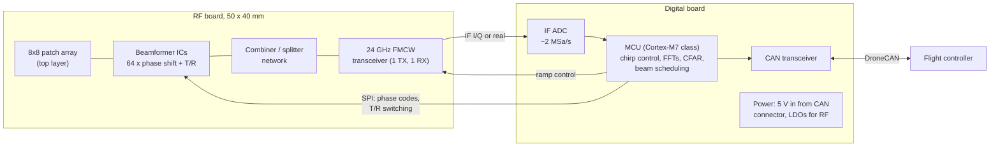

# Architecture

## Signal chain

**Analog beamforming with one shared aperture.** All 64 patches transmit and receive. A beamformer channel per
element sets the phase (and, if the IC supports it, the gain) and switches between transmit and receive. The 64
channels combine into one feed for a single-channel FMCW transceiver. The MCU steers the beam by writing a new set
of phase codes between chirp frames (`firmware/lib/beam.c`).

Why not the alternatives:

- **Digital beamforming (64 receive channels):** 64 ADCs and the data rate to match don't fit the board, the
  power budget or an MCU.
- **MIMO virtual array (for example 3 TX × 4 RX):** this is cheaper and lower power, but it gives a much smaller
  effective aperture than 8 × 8, so its angular resolution is coarser. It's worth keeping as a fallback; see the open
  decisions below.

## Frame timing

A frame is 64 chirps of 128 µs, about 8.2 ms, at one beam position (`tools/radar_budget.py`). A scan visits a
set of beam positions:

| Scan pattern | Beams | Full-scan time |
|---|---|---|
| ±45° az, one elevation row, 15° steps | 7 | ~57 ms (17 Hz) |
| ±60° az × ±30° el, 15° steps | 9 × 5 = 45 | ~370 ms (2.7 Hz) |

The update rate per direction is what limits obstacle-avoidance use, so the default pattern is a single row
centred on the direction of travel. Wide scans run when the drone is hovering.

## Processing (per frame)

1. Range FFT over the 256 samples of each chirp (windowed).
2. Doppler FFT across the 64 chirps, giving a range-Doppler map.
3. 2-D CA-CFAR detection, then peak grouping.
4. Angle: start with the beam-pointing direction. Then refine it with an amplitude monopulse between adjacent
   beams (needs no extra hardware).
5. Publish `aerki.radar.Detections` (strongest 16) and the nearest boresight return as a standard range-sensor
   message.

A 256 × 64 complex FFT on a Cortex-M7 at about 500 MHz with CMSIS-DSP takes a few milliseconds. That's within one
8 ms frame, but the MCU sizing must be checked once the chirp parameters are frozen.

## Power

Beamformer ICs dominate the budget. Typical mmWave beamformers draw on the order of tens of mW per channel or more,
so 64 channels can mean **several watts** while active. That is significant for a small drone. Mitigations, in
order:

1. Duty-cycle the RF front end: power the beamformers only during chirps.
2. Run a smaller sub-array in a low-power "watch" mode, and switch to the full 64 elements when something is
   detected.
3. Fall back to a MIMO architecture if the measured power is unacceptable.

## Mechanical

Two stacked boards joined by a board-to-board connector:
- **RF board:** patches on the front, beamformers on the back.
- **Digital board:** MCU, ADC, power and the CAN connectors.

A thin radome (0.5 mm, low-loss plastic) goes over the array. Its thickness should be about λ/2 in the material, or
much thinner than λ, to avoid reflection loss. See [../hardware/README.md](../hardware/README.md).

## Open decisions

| Decision | Options | Blocking |
|---|---|---|
| Beamformer IC | Must cover **24.00 – 24.25 GHz**. Many 5G FR2 beamformers start at 24.25 GHz, so check the datasheet's band edge, not the marketing range. Prefer 6-bit phase, T/R switching, SPI with fast beam-state registers. | RF schematic |
| FMCW transceiver | Single-channel 24 GHz ISM radar MMIC with an on-chip VCO or external PLL. | RF schematic |
| Architecture fallback | Full 8 × 8 analog vs. a MIMO virtual array, decided on power and cost | Schematic |
| MCU | STM32H7-class (FDCAN, DSP, fast SPI) is assumed | Digital board |
| Firmware base | Custom firmware on libcanard, or a radar driver inside ArduPilot's AP_Periph | Firmware start |
